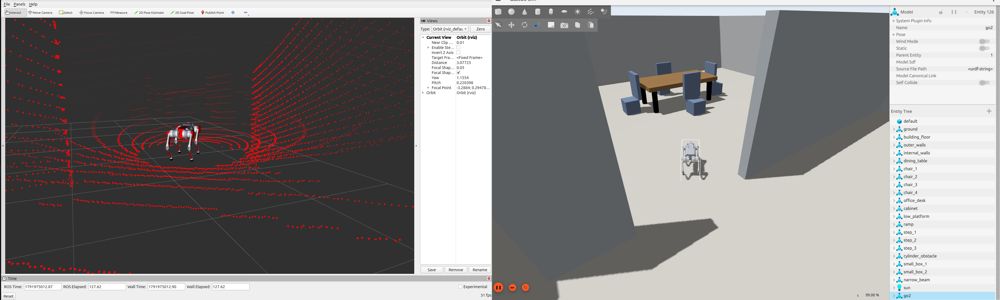
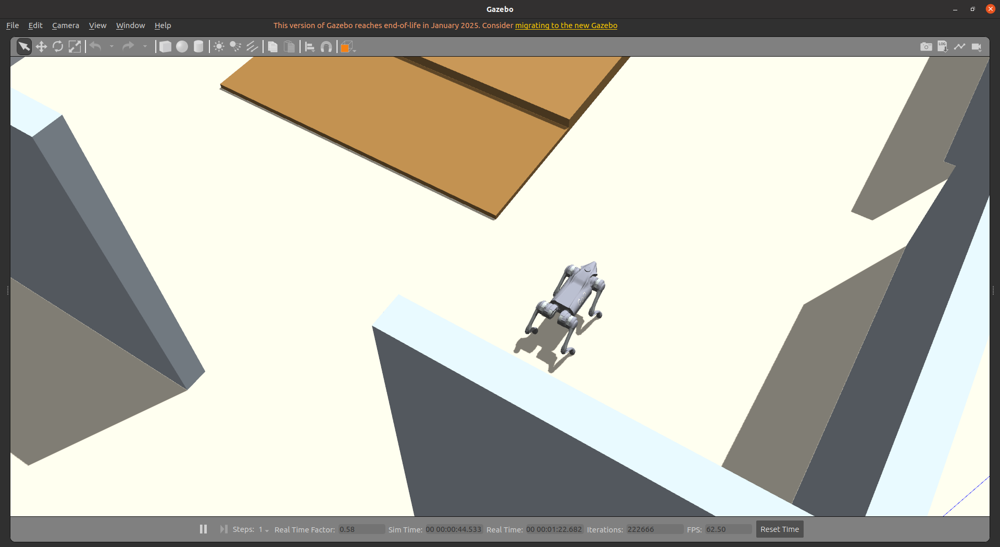
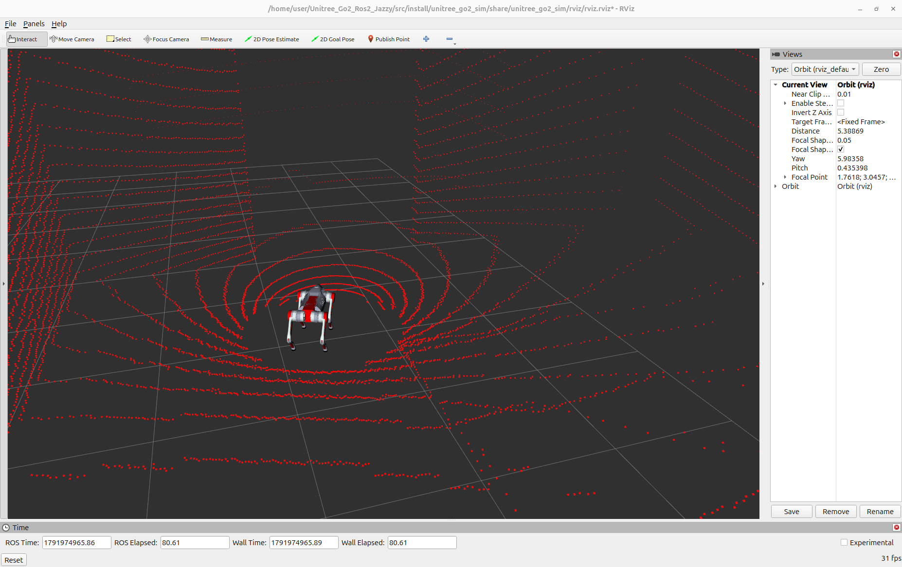

<div align="center">

# Unitree Go2 — ROS 2 Humble Simulation

**A complete Gazebo Fortress simulation and control stack for the Unitree Go2 (Ubuntu 22.04 / ROS 2 Humble port).**

[](https://docs.ros.org/en/humble/)
[](https://releases.ubuntu.com/jammy/)
[](https://gazebosim.org/docs/fortress/)
[](#requirements)

Robot description · `ros2_control` · Gazebo worlds · RViz visualization · keyboard, joystick, and BLE control



<sub>Gazebo Harmonic simulation and live Unitree L1 point cloud visualization in RViz.</sub>

[Project changes](#project-changes-and-attribution) · [Quick start](#quick-start) · [Control](#control-the-robot) · [Topics](#main-ros-2-topics) · [Troubleshooting](#troubleshooting)

</div>

## Overview

This `humble` branch provides ROS 2 Humble packages for simulating and
controlling a Unitree Go2 in Gazebo Fortress on Ubuntu 22.04. It is a port of
the ROS 2 Jazzy / Gazebo Harmonic version on the `main` branch; launch commands
and controls are the same on both. It brings the robot model, controllers, sensor
bridges, visualization, example worlds, and operator input into one workspace.

### Highlights

- Go2 URDF/Xacro model with `gz_ros2_control`
- Gazebo worlds for flat ground, elevation, city, and custom indoor tests
- Simulated IMU, RGB camera, Unitree L1 LiDAR, and added contact sensing on all four feet
- Live robot model, camera, odometry, and point cloud visualization in RViz
- Dynamic `odom -> base_link` transform published from Gazebo odometry
- Keyboard, standard `sensor_msgs/Joy`, combined, and Unitree BLE remote input
- Bundled Unitree low-level messages and per-joint ROS 2 controller
- Isolated Gazebo transport partition on every launch to avoid stale-session collisions

## Project changes and attribution

This repository builds on work from the Unitree open-source
community, while replacing and extending several parts of the original stack:

- The starting Go2 simulation from
  [anujjain-dev/unitree-go2-ros2](https://github.com/anujjain-dev/unitree-go2-ros2)
  used the CHAMP controller. CHAMP was removed from this repository.
- The active locomotion/controller stack was migrated from
  [Unitree Robotics' `unitree_ros`](https://github.com/unitreerobotics/unitree_ros),
  with [Atharva-05/unitree_ros2_sim](https://github.com/Atharva-05/unitree_ros2_sim)
  used as an additional ROS 2 simulation and migration reference.
- **Hadi added contact sensors for all four feet**, exposed as ROS 2 contact
  topics for simulation and control development.
- **The AUB Robotics Team created the custom indoor simulation world** shown in
  the screenshots, including walls, furniture, ramps, steps, and obstacles.
- **Joystick support was added**, including a bundled BLE bridge that lets the
  physical Unitree Go2 remote connect directly over Bluetooth and publish
  standard `sensor_msgs/Joy` messages.

These changes provide a controller path based on Unitree's stack without the
CHAMP dependency, originally targeting Ubuntu 24.04, ROS 2 Jazzy, and Gazebo
Harmonic (`main` branch). This `humble` branch ports it to Ubuntu 22.04, ROS 2
Humble, and Gazebo Fortress; see [Requirements](#requirements) for the
differences.

## Screenshots

<table>
  <tr>
    <td width="50%" align="center">
      <br>
      <strong>Gazebo Harmonic</strong><br>
      Go2 in an indoor world with walls, furniture, ramps, and obstacles.
    </td>
    <td width="50%" align="center">
      <br>
      <strong>RViz</strong><br>
      Robot state and live L1 LiDAR point cloud on <code>/unitree_lidar/points</code>.
    </td>
  </tr>
</table>

## Repository layout

| Package | Purpose |
| --- | --- |
| `unitree_go2_description` | Go2 Xacro model, meshes, sensors, and Gazebo worlds |
| `unitree_go2_sim` | Gazebo/RViz launches, bridges, and controller configuration |
| `ros2_unitree_legged_msgs` | Unitree low-level command and state messages |
| `ros2_unitree_legged_controller` | Per-joint `ros2_control` plugin |
| `unitree_guide2` | Go2 state machine and keyboard, joystick, or BLE input |

## Requirements

- Ubuntu 22.04 (amd64)
- ROS 2 Humble Desktop
- Gazebo Fortress (`ign gazebo` 6) with the Humble `ros_gz` and `gz_ros2_control`
  packages (`ros-humble-ros-gz`, `ros-humble-gz-ros2-control`)
- Bluetooth adapter only when using the Unitree Go2 BLE remote

### Differences from the original Ubuntu 24.04 / Jazzy / Harmonic version

On Humble, the binary `ros_gz` and `gz_ros2_control` packages are built for
Gazebo Fortress, not Harmonic, so this port targets Fortress:

- World and URDF system plugins use the Fortress names
  (`ignition-gazebo-*-system`, `ignition::gazebo::systems::*`) and
  `libgz_ros2_control-system.so`; world files are SDF 1.9.
- `default.sdf` uses Fortress's default physics engine (DART) instead of
  `bullet-featherstone`, which Fortress does not provide.
- The launch file always starts Fortress (`gz_version:=6`), even when Gazebo
  Harmonic is also installed, and sets `IGN_PARTITION` alongside `GZ_PARTITION`.
- Each leg joint has a `ros2_control` `initial_value`, so the Go2 spawns in its
  lying-down pose (hip 0, thigh 1.36, calf -2.65). Fortress does not move a
  joint that spawns outside its limits back into range, and the calf range
  excludes 0. Without this, the first stand command makes the calf chatter
  against its stop and flips the robot.

> [!NOTE]
> The bundled Unitree joint-control binary is currently built for amd64.

## Quick start

### 1. Clone and install dependencies

```bash
source /opt/ros/humble/setup.bash

mkdir -p ~/go2_ws/src
cd ~/go2_ws/src
git clone -b humble https://github.com/AUB-RoboticsTeam/unitree_go2_ros2_jazzy.git

cd ~/go2_ws
sudo rosdep init 2>/dev/null || true
rosdep update
rosdep install --from-paths src --ignore-src -r -y --rosdistro humble
```

`rosdep` installs the declared ROS and system dependencies, including BlueZ,
LCM, Eigen, ROS-Gazebo, and ROS 2 Control.

### 2. Build the workspace

```bash
cd ~/go2_ws
source /opt/ros/humble/setup.bash
colcon build --symlink-install
source install/setup.bash
```

Source `~/go2_ws/install/setup.bash` in every new terminal that uses this
workspace.

### 3. Launch Gazebo and RViz

```bash
ros2 launch unitree_go2_sim unitree_go2_launch.py
```

The default launch starts the elevation world, spawns the Go2, loads its joint
controllers, bridges the simulated sensors to ROS 2, and opens RViz.

## Simulation options

Run without the Gazebo and RViz windows:

```bash
ros2 launch unitree_go2_sim unitree_go2_launch.py gui:=false rviz:=false
```

Select another included world:

```bash
ros2 launch unitree_go2_sim unitree_go2_launch.py \
  world:=$(ros2 pkg prefix unitree_go2_description)/share/unitree_go2_description/worlds/city.sdf
```

Change the initial robot pose:

```bash
ros2 launch unitree_go2_sim unitree_go2_launch.py \
  world_init_x:=0.0 world_init_y:=0.0 world_init_z:=0.5 \
  world_init_heading:=0.0
```

Launch the TI-building world with its configured starting pose:

```bash
ros2 launch unitree_go2_sim unitree_go2_launch_TI.py
```

RViz uses `odom` as its fixed frame. The simulation publishes a dynamic
`odom -> base_link` transform, so the robot moves relative to the RViz grid.

## Control the robot

Start the simulation first, then launch `unitree_guide2` in a second terminal.

Choose one of the three input modes below.

### Keyboard only

```bash
ros2 launch unitree_guide2 junior_ctrl.launch.py input_mode:=keyboard
```

| Key | Action | Key | Action |
| --- | --- | --- | --- |
| `1` | Passive | `2` | Fixed stand |
| `3` | Free stand | `4` | Trotting |
| `W` / `S` | Forward / backward | `A` / `D` | Lateral motion |
| `I` / `K` | Pitch input | `J` / `L` | Yaw input |
| `Arrow Up` | Increase speed | `Arrow Down` | Decrease speed |
| `Space` | Reset motion input | `0`, `9`, `8` | Balance, swing, and step tests |

> [!CAUTION]
> Change states deliberately and keep the simulated robot clear of obstacles
> while testing stand, gait, balance, swing, or step modes.

### Joystick only

**Unitree Go2 remote (Bluetooth).** By default the launch also starts the BLE
bridge, which connects to the remote and publishes `/joy`. Pass your remote's
Bluetooth address (find it with `bluetoothctl`, then `scan on`):

```bash
ros2 launch unitree_guide2 junior_ctrl.launch.py input_mode:=joystick \
  unitree_address:=XX:XX:XX:XX:XX:XX
```

**Standard USB/Bluetooth gamepad.** Start the ROS `joy` driver and turn off the
BLE bridge:

```bash
ros2 run joy joy_node    # separate terminal
ros2 launch unitree_guide2 junior_ctrl.launch.py input_mode:=joystick use_unitree_ble:=false
```

Press **A** to stand and **Start** to trot, then drive with the sticks. Button
indices default to an Xbox-style layout (`A` = 0, `Start` = 7). For other
gamepads, check the indices with `ros2 topic echo /joy` and override them, e.g.
`ros2 run unitree_guide2 junior_ctrl --ros-args -p input_mode:=joystick -p joy.button_a:=1 -p joy.button_start:=9`.

Use D-pad Up to increase speed and D-pad Down to decrease it. The Unitree Go2
remote uses buttons `12` and `14`; standard joystick D-pad axis `7` is also
supported. The maximum linear speed starts at 0.5 m/s and changes in 0.1 m/s
steps between 0.1 m/s and 1.2 m/s. The yaw-rate limit changes with the same
setting, reaching 4.5 rad/s at the maximum speed setting.

Confirm the joystick before starting the controller:

```bash
ros2 topic hz /joy
ros2 topic echo /joy --once
```

### Keyboard and joystick

```bash
ros2 launch unitree_guide2 junior_ctrl.launch.py input_mode:=both
```

Both keyboard arrows and joystick D-pad buttons select a maximum linear speed
from 0.1 m/s to 1.2 m/s. The yaw-rate limit scales proportionally from
0.375 rad/s to 4.5 rad/s. The most recently active input source controls the
robot.

> [!CAUTION]
> The selected value is a commanded planar-speed limit, not a guarantee that
> the simulated robot will remain stable or reach that speed in every world.
> Increase it gradually and keep the robot clear of obstacles.

## Main ROS 2 topics

| Topic | Type | Description |
| --- | --- | --- |
| `/odom` | `nav_msgs/msg/Odometry` | Gazebo 3D odometry |
| `/tf` | `tf2_msgs/msg/TFMessage` | `odom -> base_link` and robot transforms |
| `/imu/data` | `sensor_msgs/msg/Imu` | Simulated IMU |
| `/rgb_image` | `sensor_msgs/msg/Image` | Front RGB camera |
| `/unitree_lidar/points` | `sensor_msgs/msg/PointCloud2` | Unitree L1 point cloud |
| `/feet/FR/contacts` | `ros_gz_interfaces/msg/Contacts` | Front-right foot contact data |
| `/feet/FL/contacts` | `ros_gz_interfaces/msg/Contacts` | Front-left foot contact data |
| `/feet/RR/contacts` | `ros_gz_interfaces/msg/Contacts` | Rear-right foot contact data |
| `/feet/RL/contacts` | `ros_gz_interfaces/msg/Contacts` | Rear-left foot contact data |
| `/joy` | `sensor_msgs/msg/Joy` | Joystick or Unitree BLE remote input |

## Troubleshooting

> [!IMPORTANT]
> Run `clean_sim.sh` (below) between launches. A leftover Gazebo from an
> earlier run keeps publishing `/imu/data` and `/odom` on the same ROS topics,
> and `junior_ctrl` then mixes the two robots' data and can fall while trotting.

### A fresh launch fails or the robot does not spawn

Clean up processes left by an interrupted Gazebo session, then launch again:

```bash
$(ros2 pkg prefix unitree_go2_sim)/lib/unitree_go2_sim/clean_sim.sh
```

### RViz does not follow the robot

Verify the odometry transform:

```bash
ros2 run tf2_ros tf2_echo odom base_link
```

### The point cloud is missing

Confirm that the Gazebo bridge is publishing the L1 stream:

```bash
ros2 topic hz /unitree_lidar/points
ros2 topic echo /unitree_lidar/points --once
```

### A dependency is missing

```bash
cd ~/go2_ws
rosdep check --from-paths src --ignore-src --rosdistro humble
```

## Acknowledgements

- [Unitree Robotics — `unitree_ros`](https://github.com/unitreerobotics/unitree_ros): source of the migrated Unitree locomotion/controller stack
- [Atharva-05 — `unitree_ros2_sim`](https://github.com/Atharva-05/unitree_ros2_sim): ROS 2 simulation and controller-migration reference
- [anujjain-dev — `unitree-go2-ros2`](https://github.com/anujjain-dev/unitree-go2-ros2): original CHAMP-based Go2 simulation foundation
- **Hadi and the AUB Robotics Team**: ROS 2 Jazzy/Gazebo Harmonic migration, CHAMP removal, four-foot contact sensing, custom world, and joystick/BLE integration
- ROS 2 Humble / Gazebo Fortress port for Ubuntu 22.04 (`humble` branch)

## License

Individual bundled components retain the licenses declared in their package
manifests and source files. A repository-wide license has not yet been declared.
